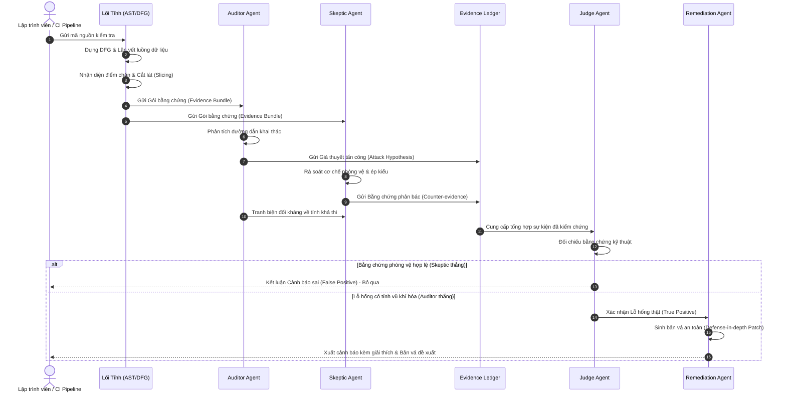

# Đặc Tả Kiến Trúc Hệ Thống Aegis-SAST (Multi-Agent Hybrid Architecture)
## Hướng Dẫn Chi Tiết Phục Vụ Thiết Kế Sơ Đồ Trên Excalidraw

Tài liệu này được biên soạn riêng để bạn dễ dàng dựng sơ đồ kiến trúc hoàn chỉnh trên **Excalidraw**. Toàn bộ hệ thống được chia thành các phân khu rõ ràng, kèm thông số màu sắc, nội dung từng khối (Box), nhãn mũi tên (Arrows) và mã **Mermaid copy-paste trực tiếp** vào Excalidraw.

---

## 1. Tổng Quan Bố Cục Không Gian (Layout Canvas)

Để sơ đồ đẹp mắt, trực quan và chuẩn phong cách kỹ thuật doanh nghiệp, bạn nên bố trí Canvas theo hướng **Từ Trái sang Phải (Left-to-Right)** hoặc **Từ Trên xuống Dưới (Top-to-Bottom)** thành 4 phân vùng chính (Zones):

```
┌─────────────────┐     ┌────────────────────────────────┐     ┌────────────────────────────────┐     ┌─────────────────┐
│     ZONE 1      │     │             ZONE 2             │     │             ZONE 3             │     │     ZONE 4      │
│   ĐẦU VÀO DỰ ÁN │ ──► │     LÕI PHÂN TÍCH TĨNH TẤT ĐỊNH│ ──► │  CỤM ĐA TÁC TỬ THẨM ĐỊNH (AI)  │ ──► │  ĐẦU RA & GIAO  │
│ (TARGET SOURCE) │     │     (DETERMINISTIC TAINT CORE) │     │      (MULTI-AGENT CLUSTER)     │     │      DIỆN       │
└─────────────────┘     └────────────────────────────────┘     └────────────────────────────────┘     └─────────────────┘
```

---

## 2. Chi Tiết Từng Khối (Component Box Specifications)

### ZONE 1: ĐẦU VÀO DỰ ÁN (Target Source & Rules)
*Màu gợi ý trong Excalidraw: Nền xám nhạt (`#f1f3f5`), viền xám đậm (`#495057`)*

- **Khối 1.1: Target Codebase (Mã nguồn dự án)**
  - *Nội dung trong Box:*
    - Multi-Language Code (Python, Java, JS/TS)
    - Web Frameworks (FastAPI, Django, Flask, Express)
    - Public API Entrypoints (Routes, Controllers)
- **Khối 1.2: Security Rule Profiles (Hồ sơ quy tắc an toàn)**
  - *Nội dung trong Box:*
    - OWASP Top 10 & CWE Taxonomy
    - Sink Definitions (Hàm nhạy cảm)
    - Custom Enterprise Policies

---

### ZONE 2: LÕI PHÂN TÍCH TĨNH TẤT ĐỊNH (Deterministic AST & DFG Taint Core)
*Màu gợi ý trong Excalidraw: Nền xanh dương pastel (`#e7f5ff`), viền xanh đậm (`#1971c2`)*

Khối lớn bao bọc (Container): **Deterministic Static Analysis Engine**
Bên trong gồm 4 khối con:

- **Khối 2.1: Tree-sitter AST Parser (Phân tích cú pháp)**
  - *Nội dung trong Box:*
    - Cây cú pháp chuẩn hóa (Normalized AST)
    - Trích xuất lời gọi hàm & phép gán
    - Ngữ pháp đa ngôn ngữ (Language Agnostic)

- **Khối 2.2: Cross-File DFG Engine (Đồ thị luồng dữ liệu)**
  - *Nội dung trong Box:*
    - Intra-file Dataflow Graph (Nội tệp)
    - Inter-file Call Graph & Reachability (Liên tệp)
    - Lần vết từ Source qua các biến trung gian đến Sink

- **Khối 2.3: Framework Defense Modeling (Mô hình hóa phòng vệ)**
  - *Nội dung trong Box:*
    - Nhận diện điểm chặn (Barrier Guards): Ép kiểu (int, float, UUID)
    - Thư viện làm sạch chuẩn: bleach, defusedxml
    - Cơ chế phòng thủ Framework: ORM, Auto-escape

- **Khối 2.4: Program Slicing (Bộ trích xuất lát cắt mã)**
  - *Nội dung trong Box:*
    - Cắt lọc tối thiểu các dòng liên quan tới luồng vấy bẩn
    - Tối ưu ngữ cảnh, chống bùng nổ token
    - Đóng gói thành: **Evidence Bundle (Gói bằng chứng)**

> **Dữ liệu chuyển giao giữa Zone 2 và Zone 3:**  
> **Gói bằng chứng (Evidence Bundle):** Gồm Nguồn đầu vào (Source), Đích nhạy cảm (Sink), Đồ thị các biến trung gian (Taint Path), Trạng thái điểm chặn (Barrier State) và Đoạn mã rút gọn (Code Slice).

---

### ZONE 3: CỤM ĐA TÁC TỬ THẨM ĐỊNH BẰNG CHỨNG (Multi-Agent Cluster)
*Màu gợi ý trong Excalidraw: Nền tím nhạt (`#f3f0ff`), viền tím đậm (`#6741d9`)*

Khối lớn bao bọc (Container): **Evidence-Based Multi-Agent Triage**
Bên trong bố trí 3 tác tử tranh luận theo vòng lặp và 1 tác tử giải pháp:

- **Khối 3.1: Auditor Agent (Tác tử Kiểm toán / Tấn công)**
  - *Màu nhấn:* Nền đỏ cam pastel (`#ffe8cc`), viền cam (`#d9480f`)
  - *Nội dung trong Box:*
    - Đóng vai trò: Kẻ tấn công (Attacker)
    - Tiếp nhận Evidence Bundle
    - Lập giả thuyết tấn công (Attack Hypothesis)
    - Tìm đường dẫn kích hoạt khả thi từ bên ngoài

- **Khối 3.2: Skeptic Agent (Tác tử Phản biện / Phòng thủ)**
  - *Màu nhấn:* Nền xanh lá nhạt (`#ebfbee`), viền xanh lá đậm (`#2b8a3e`)
  - *Nội dung trong Box:*
    - Đóng vai trò: Chuyên gia phòng thủ (Defender)
    - Tìm kiếm bằng chứng phản bác (Counter-evidence)
    - Rà soát điều kiện biên (Bounds Check), ép kiểu ngầm, cấu hình an toàn
    - Bác bỏ các giả thuyết không có tính vũ khí hóa

- **Khối 3.3: Sổ cái Bằng chứng (Evidence Ledger)**
  - *Màu nhấn:* Nền vàng pastel (`#fff9db`), viền vàng nâu (`#f59f00`)
  - *Nội dung trong Box:*
    - Bảng ghi nhận lập luận hai chiều có đối chứng
    - Lưu vết dòng code, tên biến và điều kiện bảo vệ

- **Khối 3.4: Judge Agent (Tác tử Trọng tài)**
  - *Màu nhấn:* Nền tím pastel (`#eebefa`), viền tím đậm (`#862e9c`)
  - *Nội dung trong Box:*
    - Phân xử tranh biện dựa trên Evidence Ledger
    - Ra phán quyết: Lỗ hổng thật (True Positive) hay Cảnh báo sai (False Positive)
    - Chấm điểm độ tin cậy (Confidence Score)

- **Khối 3.5: Remediation Agent (Tác tử Đề xuất Bản vá)**
  - *Màu nhấn:* Nền xanh ngọc (`#e6fcf5`), viền xanh ngọc đậm (`#0ca678`)
  - *Nội dung trong Box:*
    - Sinh giải thích kỹ thuật theo chuỗi nguyên nhân
    - Tự động sinh bản vá mã nguồn an toàn (Remediation Patch)
    - Áp dụng nguyên lý phòng thủ chiều sâu (Defense-in-Depth)

---

### ZONE 4: ĐẦU RA DOANH NGHIỆP & GIAO DIỆN (Enterprise Delivery)
*Màu gợi ý trong Excalidraw: Nền xanh lá pastel (`#d3f9d8`), viền xanh lục (`#2b8a3e`)*

- **Khối 4.1: Interactive Web Dashboard (Giao diện web trực quan)**
  - *Nội dung trong Box:*
    - Trực quan hóa đồ thị Taint Graph (Source -> Sink)
    - Hiển thị biên bản tranh biện Auditor vs Skeptic
    - Trình so sánh mã nguồn trước/sau khi vá (Diff Viewer)
- **Khối 4.2: Enterprise CI/CD & SARIF Gateway**
  - *Nội dung trong Box:*
    - Xuất chuẩn quốc tế SARIF / JSON
    - Tích hợp GitHub Actions / GitLab CI
    - Chặn merge yêu cầu kéo (PR/MR Block) nếu có lỗ hổng thật
- **Khối 4.3: One-Click Remediation (Bản vá một chạm)**
  - *Nội dung trong Box:*
    - Tự động tạo Pull Request với bản vá an toàn

---

## 3. Bảng Chi Tiết Các Mũi Tên & Luồng Dữ Liệu (Connectors)

Khi vẽ trên Excalidraw, bạn nối các mũi tên có nhãn chữ (Labels) như sau:

| STT | Điểm Bắt Đầu (From) | Điểm Kết Thúc (To) | Nhãn Trên Mũi Tên (Arrow Label) | Ý Nghĩa Kỹ Thuật |
|:---:|:---|:---|:---|:---|
| 1 | Target Codebase | Tree-sitter Parser | `Source Files` | Đọc mã nguồn đa ngôn ngữ |
| 2 | Tree-sitter Parser | Cross-File DFG Engine | `AST Nodes` | Chuyển đổi cây cú pháp thành đồ thị |
| 3 | Framework Defense Modeling | Cross-File DFG Engine | `Barrier Specs` | Cung cấp tri thức về điểm chặn và framework |
| 4 | Cross-File DFG Engine | Program Slicing | `Taint Paths` | Chuyển các đường dẫn vấy bẩn khả nghi |
| 5 | Program Slicing | Auditor & Skeptic Agents | **Evidence Bundle** | Gói lát cắt mã + biến + điểm kích hoạt |
| 6 | Auditor Agent | Evidence Ledger | `Attack Hypothesis` | Gửi giả thuyết khai thác và đường dẫn tấn công |
| 7 | Skeptic Agent | Evidence Ledger | `Defense Proof` | Gửi bằng chứng phòng vệ và điểm làm sạch |
| 8 | Auditor Agent | Skeptic Agent | `Adversarial Debate` | Mũi tên 2 chiều: Tranh luận đối kháng |
| 9 | Evidence Ledger | Judge Agent | `Verified Facts` | Cung cấp toàn bộ sự kiện đã đối chiếu |
| 10 | Judge Agent | Remediation Agent | `Confirmed TP` | Chuyển giao các lỗ hổng đã xác nhận thật |
| 11 | Judge Agent | Interactive Web Dashboard | `Triage Verdict & Logs` | Gửi kết quả phân loại và nhật ký tranh biện |
| 12 | Remediation Agent | Web Dashboard & CI/CD | `Verified Patch & SARIF` | Xuất bản vá mã nguồn và báo cáo chuẩn hóa |

---

## 4. Mã Mermaid Để Import Trực Tiếp Vào Excalidraw

> [!TIP]
> **Cách đưa vào Excalidraw cực nhanh (dưới 10 giây):**
> 1. Mở trang [excalidraw.com](https://excalidraw.com).
> 2. Chọn biểu tượng công cụ **More tools** (hoặc dấu 3 chấm / biểu tượng hình khối).
> 3. Chọn **Mermaid to Excalidraw**.
> 4. Dán toàn bộ khối mã Mermaid bên dưới vào và bấm **Insert**. Hệ thống sẽ tự động vẽ ra toàn bộ các hộp và mũi tên. Sau đó bạn chỉ cần đổi màu pastel và kéo giãn theo ý muốn!

### Biểu đồ 1: Sơ Đồ Khối Kiến Trúc Toàn Cảnh (Architecture Overview)

```mermaid
flowchart LR
    subgraph ZONE1["ZONE 1: ĐẦU VÀO DỰ ÁN"]
        Codebase["Mã Nguồn Đa Ngôn Ngữ\n(Python, Java, JS/TS)"]
        Rules["Hồ Sơ Quy Tắc An Toàn\n(OWASP Top 10 & CWE)"]
    end

    subgraph ZONE2["ZONE 2: LÕI PHÂN TÍCH TĨNH TẤT ĐỊNH (AST & DFG TAINT CORE)"]
        Parser["Tree-sitter AST Parser\n(Phân tích cú pháp chuẩn hóa)"]
        DFG["Cross-File DFG Engine\n(Đồ thị luồng dữ liệu & Gọi hàm)"]
        DefenseModel["Framework Defense Modeling\n(Nhận diện Barrier & Sanitizer)"]
        Slicer["Program Slicing\n(Trích xuất lát cắt tối thiểu)"]
    end

    subgraph ZONE3["ZONE 3: CỤM ĐA TÁC TỬ THẨM ĐỊNH BẰNG CHỨNG (MULTI-AGENT CLUSTER)"]
        Auditor["Auditor Agent\n(Tác tử Kiểm toán / Đặt giả thuyết)"]
        Skeptic["Skeptic Agent\n(Tác tử Phản biện / Tìm phòng vệ)"]
        Ledger["Sổ Cái Bằng Chứng\n(Evidence Ledger)"]
        Judge["Judge Agent\n(Tác tử Trọng tài / Ra phán quyết)"]
        Remediation["Remediation Agent\n(Tác tử Đề xuất bản vá)"]
    end

    subgraph ZONE4["ZONE 4: ĐẦU RA DOANH NGHIỆP & GIAO DIỆN"]
        Dashboard["Interactive Web Dashboard\n(Xem Taint Graph & Tranh biện)"]
        CICD["CI/CD Gateway & SARIF\n(Báo cáo chuẩn hóa & Chặn PR)"]
        Patch["One-Click Patch\n(Bản vá mã nguồn tự động)"]
    end

    %% Flow Connections
    Codebase --> Parser
    Rules --> DFG
    Parser --> DFG
    DefenseModel --> DFG
    DFG --> Slicer
    
    Slicer == "Evidence Bundle\n(Lát cắt mã & Luồng vấy bẩn)" ==> Auditor
    Slicer == "Evidence Bundle" ==> Skeptic

    Auditor -- "Giả thuyết tấn công" --> Ledger
    Skeptic -- "Bằng chứng phòng vệ" --> Ledger
    Auditor <--> |"Tranh biện đối kháng"| Skeptic

    Ledger --> Judge
    Judge -- "Lỗ hổng xác nhận (TP)" --> Remediation
    Judge -- "Phán quyết & Nhật ký" --> Dashboard
    
    Remediation --> Patch
    Remediation --> CICD
    Judge --> CICD
```



---

### Biểu đồ 2: Sơ Đồ Tuần Tự Chu Trình Tranh Biện Đối Kháng (Sequence Diagram)

Nếu muốn vẽ một sơ đồ dạng **Sequence Diagram** mô tả cách 3 Agent tranh luận để phân xử một cảnh báo:



---

## 5. Mẹo Định Dạng Trong Excalidraw Cho Bản Vẽ Báo Cáo Thầy

1. **Font chữ:** Chọn font `Normal` hoặc `Cascadia` / `Helvetica` để nét vẽ nhìn hiện đại, nghiêm túc (hạn chế font vẽ tay quá nguệch ngoạc khi báo cáo kỹ thuật).
2. **Bo tròn góc (Roundness):** Chọn bo góc nhẹ (`Round`) cho các hộp Box để tạo cảm giác mềm mại chuyên nghiệp.
3. **Màu nền hộp (Fill):** Chọn kiểu tô `Semi-transparent` hoặc `Solid` với các mã màu pastel nhẹ nhàng (đã ghi chú ở Phần 2). Tránh dùng màu quá đậm làm chìm chữ.
4. **Mũi tên liên kết:** Dùng nét liền (`Solid`) cho luồng dữ liệu chính và nét đứt (`Dashed`) cho luồng phản biện đối kháng.
5. **Gắn nhãn (Labels):** Các mũi tên quan trọng nhất bắt buộc phải có nhãn:
   - Nhãn `Evidence Bundle` giữa Lõi Tĩnh và AI.
   - Nhãn `Attack Hypothesis` và `Counter-evidence` giữa Auditor và Skeptic.
   - Nhãn `Remediation Patch` từ Judge/Remediation ra Dashboard.
